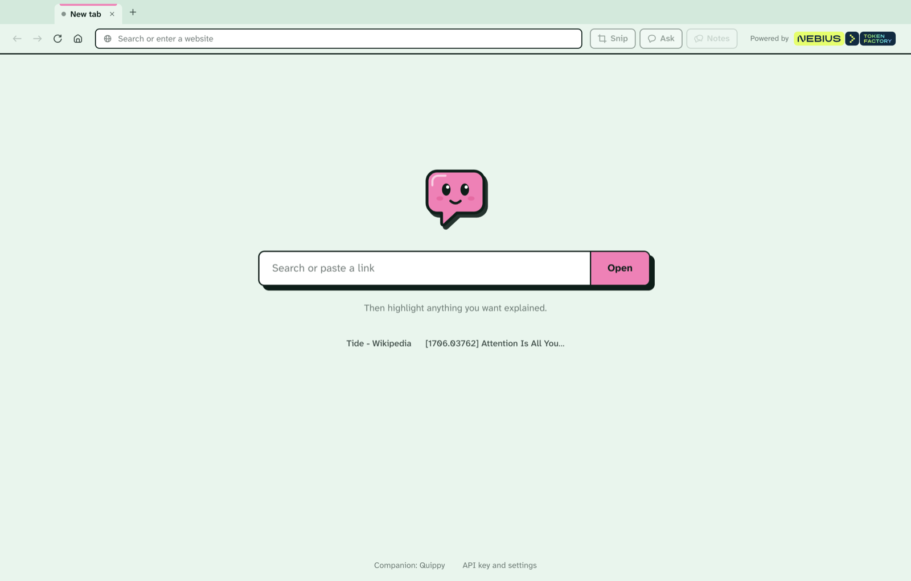

# Reading Companion

A small desktop browser with a reading companion built in. Open any website, highlight the
sentence that lost you, and a model explains it right there. Powered by
[Nebius Token Factory](https://tokenfactory.nebius.com).



## What it does

- **Opens any website as it really is.** The page view is a full Chromium browser, so sites
  render exactly as they do in Chrome: scripts, logins, sticky headers and all.
- **Tabs.** Open several pages side by side, each with its own notes. Links that ask for a
  new window open in a new tab.
- **Highlight to explain.** Select text and choose Explain, Simplify or Ask. The answer
  streams into a note pinned to the passage, which stays highlighted while you read. Keep
  asking follow-ups in the same note.
- **Ask about a picture.** Hover a picture, chart or video and press Explain picture, or
  press Snip and drag over any region. The image itself is sent to the model, along with
  its caption and nearby text.
- **Highlight part of an answer.** Select any words inside one of the companion's answers
  and the same Explain, Simplify and Ask choices appear. The follow-up stays in that note
  and carries the highlighted words with it.
- **Pictures in the conversation.** Inside any note, add a picture to your next question:
  the crop button snips part of the page into the chat, the picture button adds a file,
  and you can also paste a screenshot or drop one on the note. Up to four at a time.
- **Notes that stay put.** Closing a note keeps it: the passage stays softly highlighted
  with a marker beside it. Click the marker or the passage to reopen the whole
  conversation, or use the Notes list in the toolbar. The bin icon deletes a note. Notes
  last until you leave or reload the page.
- **Ask the page.** Click the companion (or press Ask) for a summary, the main point, or
  any question about the page. Clicking it again picks the same conversation back up.
- **A companion.** Quippy, a speech bubble with opinions. It glides over to whatever you
  highlight, raises an eyebrow while the model thinks, points at the note while the
  answer streams, and looks pleased when it lands. Left alone it fidgets, and after a
  minute and a half of quiet it dozes off until you highlight something or point at it.
  Drag it to move its resting spot. Snippy and Tippy are there too: click the companion
  on the home screen, or the Companion link at the bottom, to switch.

## Install

Download the file for your computer from the project's releases, then:

| Your computer | File | What to do |
|---|---|---|
| Mac with Apple silicon | `Reading-Companion-<version>-mac-arm64.dmg` | Open it and drag Reading Companion to Applications |
| Mac with Intel | `Reading-Companion-<version>-mac-x64.dmg` | Same |
| Windows | `Reading-Companion-<version>-win.exe` | Run it; it installs for your user account and starts the app |
| Linux (Ubuntu, Debian) | `Reading-Companion-<version>-linux-amd64.deb` or `-arm64.deb` | `sudo apt install ./<file>.deb` |
| Linux (any) | `Reading-Companion-<version>-linux-x86_64.AppImage` or `-arm64.AppImage` | `chmod +x <file>.AppImage`, then run it |

Things to expect:

- **Windows:** the installer is not code-signed, so SmartScreen shows "Windows protected
  your PC". Choose More info, then Run anyway.
- **Linux AppImage:** on Ubuntu 24.04 and later the AppImage may refuse to start because
  of the system's sandbox rules. Use the `.deb` there.
- **Mac:** release builds are signed and notarised, so they open normally.

On first launch a pop-up asks for your Nebius Token Factory key, because explanations
cannot work without one. Create a key at https://tokenfactory.nebius.com, copy it, and
press **Use the key I copied**. The app checks the key with Token Factory and saves it. If
you would rather type it into a file, choose **Open settings file instead**, paste the key
after `NEBIUS_API_KEY=` and save; the app notices on its own.

Until a key is set, the pop-up returns whenever you ask for an explanation and a pink
**Add API key** button stays in the toolbar. Browsing works without a key.

The key lives in a plain text file, `settings.txt`, in the app's data folder:

| System | Folder |
|---|---|
| macOS | `~/Library/Application Support/Reading Companion/` |
| Windows | `%APPDATA%\Reading Companion\` |
| Linux | `~/.config/Reading Companion/` |

To change the key later, use the "API key and settings" link at the bottom of the home
screen, or File > Open settings file.

## What leaves your computer

- **Your key** goes to Nebius Token Factory with each request and nowhere else. It is read
  from the clipboard or the settings file by the app's background process; it is never
  typed into, shown in, or passed to the app window or any web page. "Use the key I
  copied" only accepts something shaped like a Token Factory key, and clears the clipboard
  once the key is saved.
- **When you ask a question**, the text of the page you are on (up to 60,000 characters),
  its address without the query string, what you highlighted or snipped, and your question
  go to Nebius so the model can answer. That includes pages you are signed in to. Nothing
  is sent until you ask.
- Nothing else is collected. There is no telemetry and no account.

## Run from source

Requires a recent Node.js (built and tested on Node 26, macOS).

```bash
cp env.example .env
```

Put your Token Factory key in `.env` as `NEBIUS_API_KEY`, then:

```bash
npm install
```

```bash
npm start
```

To open straight onto a page, pass the address:

```bash
npm start -- https://example.com
```

When running from source the app reads `.env` here, and failing that the parent folders,
so a workspace-level `.env` works. The settings file works too; `.env` wins if both set
the same value. Prefer `.env` or the settings file over exporting the key in your shell.
Set `COMPANION_SKIP_DOTENV=1` to ignore `.env` and see the first-run pop-up.

## Build the installers

All three platforms build from a Mac.

```bash
npm run dist:win
```

```bash
npm run dist:linux
```

```bash
npm run dist:mac
```

Installers land in `dist/`. Windows and Linux builds are unsigned. The Mac build is signed
and notarised when your Apple credentials are present:

1. In Xcode (Settings > Accounts > Manage Certificates) or on developer.apple.com, create
   a **Developer ID Application** certificate and make sure it is in your login keychain.
   This needs a paid Apple Developer Program membership.
2. Store notarisation credentials in the keychain once, so no password sits in a file or
   your shell history. Create an app-specific password at account.apple.com, then:

   ```bash
   xcrun notarytool store-credentials "reading-companion" --apple-id "<your Apple ID>" --team-id "<your team ID>"
   ```

3. Build with the profile named:

   ```bash
   APPLE_KEYCHAIN_PROFILE=reading-companion npm run dist:mac
   ```

electron-builder finds the certificate, signs with the hardened runtime, submits both
disk images to Apple and staples the result. Check one with
`spctl -a -vv -t install dist/<file>.dmg`; it should say "accepted" and "Notarized
Developer ID".

Without a certificate the Mac build is not signed and will not open on other Macs. For a
local build to try on your own machine:

```bash
npm run dist:mac:test
```

That writes an ad-hoc signed build with debugging left on. It is for testing only: do not
hand it out.

Release builds are hardened at package time (`electronFuses` in `package.json`): the app
binary cannot be run as plain Node, ignores `NODE_OPTIONS` and `--inspect`, only loads its
own verified code archive, and encrypts stored cookies.

## Settings

All optional. Set them in the settings file, or in `.env` when running from source.

| Variable | What it does | Default |
|---|---|---|
| `NEBIUS_MODEL` | Model that writes the explanations | `thinkingmachines/Inkling-2-Small` |
| `NEBIUS_BASE_URL` | Token Factory inference endpoint | `https://api.tokenfactory.nebius.com/v1/` |
| `NEBIUS_REASONING_EFFORT` | Reasoning effort for models that support it; `default` leaves it to the model | `low` |
| `NEBIUS_MAX_TOKENS` | Cap on each answer, reasoning included | `1600` |
| `START_URL` | Page to open at launch | home screen |
| `COMPANION_MASCOT` | Companion design: `quippy`, `snippy` or `tippy` | chosen in the app |
| `COMPANION_NAME` | Any name you like for the companion, whatever its design | the design's own name |

At launch the app checks the model against the live catalog
(`GET /v1/models?verbose=true`) and reads from it whether the model accepts images and
supports reasoning. If the ID is not being served, the home screen says so instead of
failing later. Asking about pictures needs a model with image input.

## Shortcuts

| Keys | Action |
|---|---|
| Cmd+E | Explain the current highlight |
| Cmd+Shift+S | Snip a region |
| Cmd+J | Ask about the page |
| Cmd+T / Cmd+W | New tab / close tab |
| Ctrl+Tab / Ctrl+Shift+Tab | Next / previous tab |
| Cmd+1 to Cmd+8, Cmd+9 | Go to that tab / the last tab |
| Cmd+L | Jump to the address bar |
| Cmd+, | Open the settings file |
| Cmd+[ and Cmd+] | Back and forward |
| Cmd+R | Reload the page |
| Esc | Close the note or cancel a snip |

On Windows and Linux use Ctrl where the table says Cmd. The menu bar is hidden there; Alt
shows it.

## How it works

```
src/main/           background process: window, menu, Token Factory client, settings file
src/page/           script injected into each page: reports highlights, tracks their position
src/shell/          the app window: toolbar, notes, snip tool, companions, home screen
src/shell/theme.css the whole visual identity: colours, type, shapes
assets/icons/       Gravity UI icons
assets/powered-by/  the Nebius Token Factory logo used in the toolbar
build/              app icon
```

- Each question goes to Chat Completions with streaming on and `max_tokens` set. The page
  text (up to 60,000 characters), the highlight and the text around it travel with the
  first message, so follow-ups stay grounded in the page.
- Answers are kept short on purpose: two or three plain sentences (about 50 words) for a
  first explanation, one or two for "Simpler", up to about 90 words for "Go deeper", and
  three short bullets for a page summary. The wording lives in `systemPrompt()` in
  `src/main/inference.js`.
- The line at the foot of each note names the model that answered there, as reported by
  the API, with the full model ID on hover. Change `NEBIUS_MODEL` in the settings file and
  the next question uses it, with no restart.
- A failed generation can still answer HTTP 200, so the stream is checked for an error
  payload on every chunk.
- Web pages are treated as hostile. The script the app runs inside each page only reacts
  to real mouse and keyboard input, so a page cannot fake a click to start a question.
  The app's background process only takes requests from the app's own window, paces
  questions, and never opens a real new window: links that ask for one open a tab, one at
  a time, only from the tab on screen.
- Model output is rendered as sanitised Markdown with no images, and a link in an answer
  shows the site it really goes to. Page text is passed to the model as material to
  explain, and the model has no tools.
- The "Powered by Nebius Token Factory" mark opens https://tokenfactory.nebius.com/ in your
  default browser, so the page you are reading stays where it is.
- The page view runs sandboxed with no Node access, in its own profile. Downloads, camera,
  microphone, location and notification requests are declined.

## Design

The look is the app's own, and light throughout. Four colours with jobs: deep evergreen
for text and outlines, pink (its complement) for the highlighter and anything you press,
mint for the app's own surfaces (tabs, toolbar, notes, home), white for wells. Shapes follow the companions: flat fills, a dark
outline, a hard offset shadow. Text is set in Atkinson Hyperlegible Next, a typeface drawn
for easy reading; headings in Bricolage Grotesque. To restyle it, edit
`src/shell/theme.css`.

## Test

```bash
npm run test:smoke
```

Launches the real app, opens a Wikipedia article, highlights a paragraph, asks for an
explanation and checks that an answer streams back. It uses your key and costs a fraction
of a cent. Screenshots land in `.smoke/`.

## Known limits

- Highlights inside embedded frames (an iframe from another site) are not picked up; snip
  the area instead.
- Some sites challenge automated browsers. The app presents as a regular Chrome, but a
  site's bot check can still step in.
- PDFs and other downloads are not opened.
- Tabs are not restored after the app is closed, and cannot be dragged to reorder.
- There is no automatic update. The browser engine inside the app only gets security
  fixes when a new version is installed, so treat it as a reading tool, not as your main
  browser for banking or email.
- A page can tell which of its passages you asked about (the highlight is drawn inside the
  page), and a page's wording can still mislead the model; the answer is only as
  trustworthy as the page.
- Windows and Linux builds are produced but have not been run by the author.
- Explanations cover the first 60,000 characters of very long pages.

## Credits

- Fonts: [Atkinson Hyperlegible Next](https://www.brailleinstitute.org/freefont/) and
  [Bricolage Grotesque](https://github.com/ateliertriay/bricolage), both under the SIL
  Open Font License, installed from Fontsource.
- Icons: [Gravity UI](https://gravity-ui.com/icons), MIT (notice in `assets/icons/LICENSE`).
- The Nebius Token Factory logo belongs to Nebius and is used here as a "powered by" mark.
